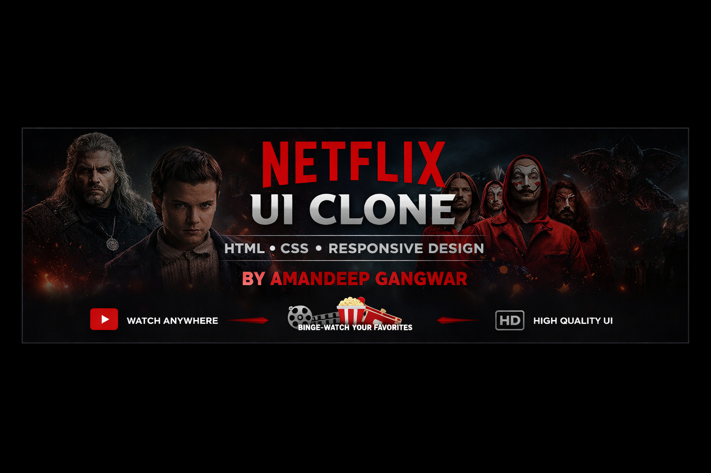

  

<h1 align="center">🎬 Netflix UI Clone</h1>

  <b>A Modern & Responsive Netflix Homepage UI built with HTML & CSS</b>

  

  
  
  

___

## 🌟 Overview

🎥 A visually stunning **Netflix UI Clone** built using **HTML & CSS** that replicates the homepage design of Netflix with a responsive layout and modern UI.

💡 This project focuses on:
- Pixel-perfect UI design  
- Responsive layouts  
- Clean and structured styling  

---

## ✨ Features

🚀 **Core Features**
- 🎬 Netflix-style homepage layout  
- 📱 Fully responsive design  
- 🎨 Clean and modern UI  
- 🧭 Navigation bar with sections  

💎 **UI Highlights**
- 🔥 Hero banner section  
- 🎞️ Movie rows & thumbnails  
- 🎨 Hover effects on cards  
- 📺 Footer section  

---

## 🛠️ Tech Stack

  

---

## 📂 Project Structure

---

## 🎨 UI Sections

- 🔝 Navbar (Logo + Menu)  
- 🎬 Hero Banner  
- 🎞️ Movie Rows  
- 📺 Footer  

---

## 🧠 Learnings

📌 This project helped me improve:
- CSS Flexbox & Grid  
- Responsive Design Techniques  
- UI Cloning & Layout Skills  
- Web Design Best Practices  

---

## 🔮 Future Enhancements

- 🎥 Add video streaming functionality  
- 🔐 User authentication (Login/Signup)  
- 🌐 Integrate movie API (like TMDB)  
- 🎨 Add animations & transitions  

---

## 🤝 Contributing

Contributions are welcome! 🚀  
Feel free to fork this repo and improve it.

---

## 📬 Contact

👨‍💻 **Amandeep Gangwar**  
📧 amandeepgangwar0@gmail.com  
🔗 [LinkedIn](https://www.linkedin.com/in/amandeepgangwar)  
🐙 [GitHub](https://github.com/amandeepgangwar1)

---

## ⭐ Show Some Love

If you like this project, give it a ⭐ on GitHub!
